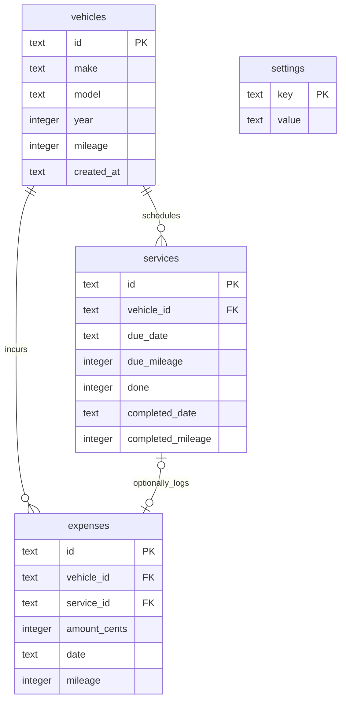

# System design

Maintainr is a local, single-device PWA. The static server serves application assets only; it never receives vehicle records. There is no API, login, remote database, or synchronization queue.

## Data model



Additional text columns preserve titles, categories, nickname, plate, vendor, and notes. Settings store the active vehicle and last export time. Indexes cover service due dates and expense dates/categories by vehicle. Calculated totals and due indicators are derived rather than duplicated.

## Saving

1. The interface collects the form and calls a domain operation.
2. Domain code produces a normalized next state, enforcing IDs, types, dates, cents, and relationships.
3. The repository opens a candidate SQLite connection from the current database snapshot. All replacement writes run under one SQL transaction using prepared statements and enabled foreign keys.
4. The candidate database is exported to bytes.
5. An IndexedDB readwrite transaction checks the stored revision and saves the bytes with an incremented revision. Both operations occur atomically across tabs.
6. Only after that transaction completes does the repository replace its live connection and the interface report success.

If validation, SQL, or persistence fails, the candidate is discarded. The current connection and persisted database remain unchanged. If another tab already saved, the stale tab receives a conflict, refreshes, and asks the user to review the current state. It does not retry a stale mutation automatically.

Replacing all table rows and persisting the entire snapshot on each save favors simplicity and atomic recovery for small garages. Large datasets or receipt attachments would justify an incremental persistent SQLite filesystem adapter and a worker. Neither is required for this scope.

## Backup format

```json
{
  "format": "maintainr-backup",
  "schemaVersion": 2,
  "exportedAt": "2026-10-14T18:30:00.000Z",
  "version": 4,
  "vehicles": [],
  "services": [],
  "expenses": [],
  "activeVehicleId": null,
  "lastExportAt": null
}
```

- `schemaVersion` versions the public backup contract.
- `version` identifies the garage representation; v3 introduced integer `amountCents`; v4 permits null service due dates and mileages. Backup format v2 carries this representation, while imports still accept format v1.
- SQLite independently tracks its physical schema in `PRAGMA user_version`.

Import parses a maximum 10 MiB file, checks the envelope, converts supported old garage versions, validates every record and relationship, and previews record counts and total expenses. Confirmation calls the same transactional repository replacement used for normal saves. CSV exports are spreadsheet reports only.

Legacy localStorage is read only when no SQLite snapshot exists. It remains intact after migration. An invalid legacy entry blocks migration with recovery controls instead of silently erasing it. An invalid SQLite database similarly fails closed rather than being replaced with an empty garage.

## Offline releases

The service worker precaches the complete release, including SQL engine JavaScript and WASM. Installation fails if any required asset cannot be fetched. A new release waits for existing clients to close, or for the user to accept reloading. User records are stored separately from cached app assets.

The runtime makes no third-party requests. Browser-managed storage remains subject to user deletion and platform policies. Versioned file backups provide recovery and manual device transfer.

SQLite migration 2 rebuilds services and linked expenses within one transaction to allow null due thresholds, preserving existing rows, links, settings, and indexes. Miles-from-now input is converted once to an absolute odometer threshold; future odometer updates do not move that target.
